# SHIELD-IoT: A Stealth-Attack Aware, Explainable, and Lightweight Intrusion Detection Framework for IoT Networks

**Omkar Raj**  
Department of Computer Science and Engineering  
*Email: omkar.raj@research.ac.in*

---

### Abstract
The proliferation of heterogeneous Internet of Things (IoT) edge appliances—ranging from edge gateways to industrial sensor hubs—has expanded the network attack surface while imposing severe constraints on computational resources. Machine Learning (ML) and Deep Learning (DL) Network Intrusion Detection Systems (NIDS) deployed in these environments face four critical obstacles: (i) high feature dimensionality that induces computational overhead; (ii) acute class imbalance wherein stealth attacks (such as Ransomware, Backdoors, and MITM) represent less than $0.1\%$ of flows and suffer low recall in unweighted models; (iii) the opaque "black-box" nature of non-linear models that impedes security auditability; and (iv) heavy runtime library dependencies that inhibit bare-metal deployment on embedded microcontrollers.

This paper presents **SHIELD-IoT**, an edge-oriented intrusion detection framework designed and statically compiled as ANSI C for IoT network flows. First, SHIELD-IoT applies a Two-Stage Hybrid Feature Selection pipeline combining ANOVA $F$-statistic dispersion filtering with TreeSHAP feature attribution, pruning the UNSW NF-ToN-IoT-v2 NetFlow feature space from 39 down to 14 attributes while retaining $96.63\%$ multi-class accuracy. Second, to address class imbalance, we evaluate a joint Borderline-SMOTE oversampling and cost-sensitive gradient boosted decision tree (`LightGBM`) pipeline. This configuration elevates Ransomware recall from $0.00\%$ (in an unweighted deep MLP baseline) and $74.29\%$ (in an unweighted 14-feature tree baseline) to **$85.71\%$**, Backdoor recall to **$97.52\%$**, and overall Macro-F1 to **$85.53\%$** across 10 classes, though Man-in-the-Middle (MITM) attacks remain challenging ($32.35\%$ recall, though $94.12\%$ are flagged as malicious in binary triage). Third, SHIELD-IoT incorporates an Open-Set Recognition (OSR) engine leveraging free-energy score calibration and Mahalanobis prototype distances to flag novel, zero-day attacks with a test AUROC of **$91.04\%$** and an out-of-sample FPR of **$5.00\%$** under strict class-held-out validation calibration. Fourth, we transpile the trained 1,000-tree ensemble into standalone ANSI C with zero dynamic memory allocation (`0 B` heap) and an $88\text{--}96\text{ byte}$ stack frame. On a host x86_64 workstation, the native C engine achieves an execution latency of **$13.79\text{ }\mu\text{s}$ per flow** ($72,528\text{ flows/s}$). Cross-compilation via LLVM for ARM Cortex-M4, Cortex-M0+, and RISC-V targets yields static Flash ROM footprints of $741.8\text{--}836.5\text{ KB}$ for the full ensemble and $418.3\text{ KB}$ for a 500-tree pruned ensemble, accompanied by analytical energy models. Local and global SHAP attributions are coupled with a template-based rule generator producing structured SIEM incident playbooks mapped to MITRE ATT&CK techniques.

**Keywords:** Intrusion Detection Systems (IDS), Internet of Things (IoT), Explainable AI (XAI), SHAP, Borderline-SMOTE, Bare-Metal C Synthesis, Open-Set Recognition, NetFlow v2.

---

## I. Introduction

The Internet of Things (IoT) connects billions of low-power appliances across civilian infrastructure, industrial supervisory systems, smart campuses, and healthcare networks. Unlike conventional enterprise IT protected by centralized firewalls, IoT deployments are geographically distributed and directly exposed to automated cyber attacks, including distributed denial-of-service (DDoS), credential brute-forcing, remote-access backdoors, command injection, and targeted ransomware [1]. While machine learning (ML) and deep neural networks (DNNs) have shown strong benchmark accuracy in network intrusion detection, deploying them directly within edge routing gateways and microcontroller-driven field units reveals four operational challenges:

1. **Dimensionality and Processing Overhead:** Standard flow datasets track dozens of statistical attributes per bidirectional session. Extracting, storing, and calculating inference over high-dimensional vectors introduces memory and latency overhead on resource-constrained gateways during burst traffic.
2. **Stealth-Attack Blindspots under Extreme Class Imbalance:** In real-world network telemetry, benign background traffic and high-volume attacks (e.g., DDoS, port scanning) account for over $90\%$ of observed flows. Conversely, advanced persistent threats (APTs) such as Backdoor beacons, Man-in-the-Middle (MITM) traffic, and pre-encryption Ransomware comprise fewer than $0.1\%$ of records. Standard deep classifiers optimizing unweighted cross-entropy loss achieve high aggregate accuracy ($>93\%$) while exhibiting zero recall on rare attack categories [2].
3. **The "Black-Box" Interpretability Deficit:** Non-linear models output raw numerical classification scores without human-auditable rationales. Security Operations Center (SOC) personnel cannot verify whether a flagged anomaly stems from legitimate protocol indicators or spurious dataset correlations, leading to operational friction.
4. **Embedded Runtime Barriers:** Standard ML workflows depend on high-level Python interpreters, PyTorch/TensorFlow runtimes, and shared dynamic libraries (`.so`/`.dll`). Bare-metal microcontrollers (such as ARM Cortex-M or RISC-V nodes) operate with fixed static memory layouts (frequently $\le 1\text{ MB}$ Flash and $\le 256\text{ KB}$ SRAM) and cannot support operating system runtimes.

To examine these challenges, this paper presents **SHIELD-IoT** (*Stealth-Attack Aware, Explainable and Lightweight Intrusion Detection Framework for IoT Networks*), evaluated on the standardized UNSW NF-ToN-IoT-v2 benchmark dataset (801,519 NetFlow records) [6].

### Core Contributions
The primary contributions of this work are:
* **Two-Stage Hybrid Feature Selection:** A dual-filter pipeline combining ANOVA $F$-test statistical dispersion with TreeSHAP global attribution that reduces the NetFlow feature space from 39 down to 14 attributes while maintaining $96.63\%$ multi-class accuracy.
* **Topological Rare Attack Mitigation:** An empirical evaluation of joint Borderline-SMOTE oversampling and cost-sensitive gradient boosted decision trees, elevating Ransomware recall to $85.71\%$ and Backdoor recall to $97.52\%$ across 160,304 test flows, while documenting the persistent challenge of MITM detection ($32.35\%$ recall, though $94.12\%$ flagged as anomalous).
* **Open-Set Zero-Day Recognition:** An epistemic uncertainty architecture combining free-energy calibration and Mahalanobis prototype distances that identifies unseen zero-day threat families with a test AUROC of $91.04\%$ and an out-of-sample FPR of $5.00\%$ under strict class-held-out validation calibration.
* **Zero-Heap Bare-Metal ANSI C Transpilation:** A code generator that synthesizes the trained 1,000-tree ensemble into static ANSI C functions requiring $0\text{ bytes}$ of dynamic heap allocation and $<96\text{ bytes}$ of stack memory. We report host execution latency ($13.79\text{ }\mu\text{s/flow}$), physical cross-compiled Flash ROM footprints via LLVM for ARM Cortex-M4 and Cortex-M0+, and analytical hardware energy projections.

---

## II. Related Work and Research Gap Analysis

### A. Lightweight Machine Learning for Edge NIDS
Dimensionality reduction is widely studied for edge-native network security. Zhang et al. [1] proposed *FCAST-RF*, utilizing Principal Component Analysis (PCA) combined with Random Forest classification to reduce feature complexity on edge gateways. However, PCA projects physical network indicators into orthogonal linear combinations, masking domain-specific packet context. Kılıç and Şengül [2] investigated *SHAP-Guided Feature Selection* across CIC-IDS datasets, demonstrating that tree-based feature attribution prunes redundant features while maintaining detection performance. Building on these principles, SHIELD-IoT preserves original NetFlow semantics by selecting a compact 14-feature subset using statistical filtering and TreeSHAP attribution.

### B. Explainable Artificial Intelligence (XAI) in Threat Triage
Recent cybersecurity literature focuses on post-hoc interpretability to assist threat verification. Pomsathit [3] proposed an interpretable pre-ransomware detection framework for SOCs using lightweight ML paired with SHAP attributions, demonstrating that flow dynamics provide actionable forensic indicators prior to file encryption. Sunny et al. [11] developed an explainable intrusion detection framework on TON_IoT telemetry for cloud infrastructures, validating that feature attribution demystifies non-linear intrusion decisions. Benaddi et al. [5] integrated SHAP-guided pruning with Kronecker network distillation to compress models for IoT nodes. SHIELD-IoT extends this direction by converting top SHAP attributions into structured, plain-English SIEM incident rule templates aligned with MITRE ATT&CK techniques.

### C. Class Imbalance and Rare Attack Baselines
Published benchmarks show that standard deep networks (MLP, 1D-CNN) trained with unweighted cross-entropy loss struggle on extreme minority classes in network telemetry. When an intrusion type comprises less than $0.05\%$ of training flows, gradient updates are dominated by majority-class loss terms, leading to low minority-class sensitivity. While basic SMOTE synthesizes samples across feature space, applying it uniformly in high dimensions can create noisy points that bridge disjoint class boundaries. SHIELD-IoT applies *Borderline-SMOTE* [9] exclusively to borderline decision regions, paired with inverse-frequency class weighting in gradient boosted trees [8].

---

## III. Proposed SHIELD-IoT Framework

The architecture of SHIELD-IoT is outlined in Fig. 1. It consists of Data Preprocessing, Two-Stage Feature Selection, Stealth-Aware Classification, Open-Set Recognition, and Bare-Metal C Synthesis.

```
+-----------------------------------------------------------------------------------------+
|                                    SHIELD-IoT Pipeline                                  |
+-----------------------------------------------------------------------------------------+
|  [Raw NetFlow v2 Telemetry: 39 Continuous & Discrete Statistical Attributes]            |
|                                         │                                               |
|                                         ▼                                               |
|  [Stage 1: ANOVA F-Test Dispersion Filter]  ──► Prunes 39 features down to 22           |
|                                         │                                               |
|                                         ▼                                               |
|  [Stage 2: TreeSHAP Global Attribution]    ──► Selects Top 14 Balanced Operating Features|
|                                         │                                               |
|                                         ▼                                               |
|  [Borderline-SMOTE Resampling + Cost-Sensitive LightGBM Engine (10 Classes)]             |
|                  │                                                  │                   |
|                  ▼                                                  ▼                   |
|  [Open-Set Energy & Prototype OSR]                  [ANSI C Model Transpilation Engine] |
|  - E(x; T) = -T ln Σ exp(f_k(x)/T)                  - 1,000 Static C Decision Trees     |
|  - Test AUROC: 91.04%                               - 0 Dynamic Allocations (0 B Heap)  |
|                                                     - Host Latency: 13.79 µs/flow       |
+-----------------------------------------------------------------------------------------+
```
*Fig. 1. Architectural overview of the SHIELD-IoT framework.*

### A. NetFlow Telemetry & Preprocessing
Evaluations are conducted on the standardized UNSW NetFlow benchmark family, primarily **NF-ToN-IoT-v2** [6]. The raw dataset records 43 flow attributes. To prevent models from learning host- or topology-specific artifacts, four direct addressing columns are removed:
$$\mathcal{D}_{\text{drop}} = \{\text{IPV4\_SRC\_ADDR}, \text{IPV4\_DST\_ADDR}, \text{L4\_SRC\_PORT}, \text{L4\_DST\_PORT}\}$$
This leaves $M = 39$ statistical NetFlow features. Rows containing infinite or missing values are removed. Continuous attributes are scaled using `RobustScaler` fitted strictly on training data:
$$x' = \frac{x - \text{median}(X_{\text{train}})}{\text{IQR}(X_{\text{train}})}$$

### B. Two-Stage Hybrid Feature Selection Formulation
Given input matrix $X \in \mathbb{R}^{N \times 39}$, feature selection proceeds in two stages:

1. **Stage 1 (Statistical Filter):** We compute the one-way ANOVA $F$-statistic for each feature $j \in \{1, \dots, 39\}$ across binary attack/benign labels:
   $$F_j = \frac{\sum_{k=0}^{1} n_k (\bar{x}_{j,k} - \bar{x}_j)^2}{\sum_{k=0}^{1} \sum_{i=1}^{n_k} (x_{j,k,i} - \bar{x}_{j,k})^2 / (N - 2)}$$
   Features are ranked by $F_j$, and the top $K_{\text{stage1}} = 22$ features with highest variance across labels are retained.
2. **Stage 2 (TreeSHAP Attribution Ranking):** A preliminary gradient boosted tree is trained on the 22 candidate features. Shapley values $\phi_j(x)$ are computed across training flows using TreeSHAP [4]:
   $$f(x) = \phi_0 + \sum_{j=1}^{22} \phi_j(x)$$
   Global feature impact is measured by mean absolute attribution:
   $$I_j = \frac{1}{|\mathcal{S}|} \sum_{i \in \mathcal{S}} \left| \phi_j(x^{(i)}) \right|$$
   Selecting the top 14 attributes yields an empirical operating subset:
   $$\mathcal{F}_{\text{final}} = \begin{Bmatrix} \text{MAX\_IP\_PKT\_LEN}, \text{TCP\_WIN\_MAX\_IN}, \text{L7\_PROTO}, \\ \text{DST\_TO\_SRC\_AVG\_THROUGHPUT}, \text{SRC\_TO\_DST\_AVG\_THROUGHPUT}, \\ \text{FLOW\_DURATION\_MILLISECONDS}, \text{MIN\_IP\_PKT\_LEN}, \text{DNS\_TTL\_ANSWER}, \\ \text{TCP\_FLAGS}, \text{SERVER\_TCP\_FLAGS}, \text{TCP\_WIN\_MAX\_OUT}, \\ \text{SHORTEST\_FLOW\_PKT}, \text{CLIENT\_TCP\_FLAGS}, \text{MIN\_TTL} \end{Bmatrix}$$

### C. Rare Attack Mitigation via Borderline-SMOTE & Cost-Sensitive Boosting
NF-ToN-IoT-v2 displays acute class imbalance: Benign traffic comprises $36.09\%$ ($289,299$ flows), Scanning accounts for $22.30\%$, while Ransomware comprises $0.02\%$ ($175$ flows), MITM $0.04\%$ ($342$ flows), and Backdoor $0.10\%$ ($806$ flows).

To mitigate this imbalance without synthesizing noisy points deep within majority clusters, **Borderline-SMOTE** [9] is applied strictly to the training split ($X_{\text{train}}, y_{\text{train}}$). For each minority sample $x_i$, its $m$ nearest neighbors in the training set are identified. Let $m'$ denote the number of neighbors from majority classes. Synthetic points are generated only for instances lying on the decision boundary where $\frac{m}{2} \le m' < m$:
$$x_{\text{new}} = x_i + \delta \cdot (x_{zi} - x_i), \quad \delta \sim U(0, 1)$$
where $x_{zi}$ is a neighbor from the same minority class. Resampling targets are set to $4,000$ flows for Backdoor, $3,500$ for MITM, and $3,000$ for Ransomware.

Subsequently, a multi-class LightGBM classifier ($100$ iterations, max depth $8$) is trained with balanced class weights:
$$w_k = \frac{N}{K \cdot N_k}$$

### D. Open-Set Zero-Day Recognition (OSR) Formulation
To identify novel attack classes not seen during training, SHIELD-IoT implements an energy-based out-of-distribution detection formulation [10] combined with prototype Euclidean distances. Let $f_k(x)$ denote the logit output of the ensemble for known class $k \in \{0, \dots, K_{\text{known}}-1\}$. Helmholtz free energy at temperature $T$ is given by [10]:
$$E(x; T) = -T \cdot \ln \sum_{k=0}^{K_{\text{known}}-1} \exp\left( \frac{f_k(x)}{T} \right)$$
In parallel, class prototype centroids $\mu_k \in \mathbb{R}^{14}$ and feature variances $\sigma_j^2$ are computed across known training flows. The normalized minimum Mahalanobis distance to known prototypes is:
$$d_{\text{proto}}(x) = \min_k \sqrt{ \sum_{j=1}^{14} \frac{(x_j - \mu_{k,j})^2}{\sigma_j^2 + \epsilon} }$$
To prevent test-set distribution leakage, the normalization statistics ($\mu_d, \sigma_d, \mu_e, \sigma_e$) are calibrated strictly on a subset of known training flows:
$$S(x) = \frac{d_{\text{proto}}(x) - \mu_d}{\sigma_d} - w_e \cdot \frac{E(x; T) - \mu_e}{\sigma_e}$$
where $w_e = 0.25$. An incoming flow is flagged as an *Unseen Zero-Day Intrusion* if $S(x) \ge \tau_{\text{OOD}}$. In our evaluation protocol, test AUROC ($91.04\%$) is assessed threshold-independently across all $160,304$ holdout test flows. The operational decision threshold $\tau_{\text{OOD}} = 1.3626$ is calibrated strictly at the 95th percentile of known validation traffic ($128,086$ flows) prior to test exposure, targeting an in-distribution false alarm rate $\le 5\%$ rather than choosing $\tau_{\text{OOD}}$ post-hoc from test anomaly recall.

### E. Bare-Metal ANSI C Transpilation
To support execution on embedded microcontrollers lacking Python runtimes, a static code synthesis script (`src/c_transpiler.py`) converts the trained 10-class ensemble ($100\text{ trees/class} \times 10\text{ classes} = 1,000\text{ trees}$) into unrolled ANSI C static functions:

```c
static inline float tree_0042(const float *x) {
    if (x[0] <= 128.500000f) {
        if (x[8] <= 2.000000f) return -0.421800f;
        else return 0.812400f;
    } else {
        if (x[1] <= 1024.000000f) return -0.115200f;
        else return 0.543100f;
    }
}
```

The master classification routine accumulates the outputs into a static array of 10 float accumulators and computes the `argmax`. This architecture ensures:
1. **Zero Dynamic Allocation:** Exactly $0\text{ bytes}$ of heap memory (`malloc`) are invoked.
2. **Bounded Stack Execution:** The execution stack frame is fixed at $88\text{--}96\text{ bytes}$ of SRAM.
3. **Branch-Driven Logic:** Nested comparisons compile to native branch instructions without requiring floating-point runtime libraries.

---

## IV. Experimental Setup & Benchmark Protocols

### A. Dataset Partitioning
Evaluations use **NF-ToN-IoT-v2** ($801,519$ flows), partitioned into an $80\%$ stratified training split ($641,215$ flows) and a $20\%$ holdout test split ($160,304$ flows). For cross-dataset domain evaluation, we evaluate transferability on balanced $20,000$-flow subsets of **NF-BoT-IoT** and **NF-UNSW-NB15** [7] ($10,000$ benign, $10,000$ attack each).

### B. Baseline Architectures
We benchmark SHIELD-IoT against multiple baseline configurations across comparative, per-class, and ablation settings:
1. **Multi-Layer Perceptron (MLP Baseline):** PyTorch DNN with 3 dense layers ($39 \to 128 \to 64 \to 10$), ReLU activations, and Dropout ($p = 0.2$), trained with standard unweighted cross-entropy loss.
2. **1D-CNN Baseline:** PyTorch DNN with Conv1D (kernel size 3, 32 channels), BatchNorm1D, MaxPool1D, and dense classification layers, trained with unweighted cross-entropy loss.
3. **Random Forest (RF Baseline):** Classical ensemble with 60 estimators and maximum depth 16 on 39 features.
4. **XGBoost Baseline:** Gradient boosted decision trees with 80 boosting rounds and maximum depth 6 on 39 features.
5. **Standard LightGBM Baseline (39-Feature):** 100 boosting rounds and maximum depth 8 on 39 features with unweighted multi-class log-loss.

To accommodate training compute constraints for neural architectures while maintaining proportional minority-class presence, Baselines 1–5 in Table I were calibrated on a stratified 150,000-flow sample. In addition, to isolate the specific impact of data rebalancing on identical feature inputs, an **Unweighted 14-Feature LightGBM Baseline** (trained on the full training split without SMOTE or cost weighting) is evaluated in Table II. Finally, a controlled 4-way ablation across both 39-feature and 14-feature dimensions on the complete 641k training split is presented in Section V-C (Table III).

### C. Hardware Profiling Targets
Host execution was benchmarked on an x86_64 workstation using high-resolution hardware timers (`QueryPerformanceCounter`). Microcontroller cross-compilation was executed using the LLVM/Zig toolchain targeting three freestanding architectures:
* **STM32F405RG / Nordic nRF52840:** ARM Cortex-M4 (ARMv7E-M Thumb-2, 64–84 MHz, 1024 KB Flash, 128–256 KB SRAM).
* **Raspberry Pi RP2040:** Dual ARM Cortex-M0+ (ARMv6-M Thumb, 133 MHz, 2048 KB Flash, 264 KB SRAM).
* **Espressif ESP32-C3:** RISC-V 32-bit RV32IMC core (160 MHz, 4096 KB Flash, 400 KB SRAM).

Actual Flash ROM (`.text` and `.rodata`) and static SRAM footprints were extracted directly from compiled ELF binaries via `llvm-size`. Per-flow latencies, energy dissipation, and battery life on MCUs are analytical projections based on datasheet operating currents and nominal clock speeds.

---

## V. Results and Empirical Analysis

### A. Master Comparative Benchmark
Table I summarizes head-to-head performance across all evaluated models on the $160,304$ holdout test flows of NF-ToN-IoT-v2.

#### TABLE I: Master Comparative Benchmark on NF-ToN-IoT-v2 (Stratified 150k Baseline Calibration)
| Model Architecture | Type | Feats | Accuracy (%) | Macro-F1 (%) | Weighted-F1 (%) | Ransomware Recall (%) | Backdoor Recall (%) | Latency (ms/1k) | Size (MB) | Deployability |
| :--- | :---: | :---: | :---: | :---: | :---: | :---: | :---: | :---: | :---: | :---: |
| **MLP Baseline** | PyTorch DNN | 39 | 93.03 | 72.68 | 93.02 | 0.00 | 97.52 | 0.381 | 0.07 | GPU / Host |
| **1D-CNN Baseline** | PyTorch DNN | 39 | 93.24 | 81.89 | 93.18 | 57.14 | 97.52 | 17.224 | 0.16 | GPU / Host |
| **Random Forest** | Classical Ensemble | 39 | 97.12 | 88.24 | 97.09 | 74.29 | 98.76 | 2.762 | 33.55 | Host / Gateway |
| **XGBoost** | Gradient Boosted | 39 | 96.40 | 87.15 | 96.35 | 74.29 | 98.76 | 3.024 | 2.07 | Host / Gateway |
| **LightGBM (Full)** | Gradient Boosted | 39 | 89.44 | 60.21 | 89.47 | 68.57 | 0.00 | 18.038 | 2.98 | Host / Gateway |
| **SHIELD-IoT (Ours)** | **Edge Transpiled** | **14** | **96.63** | **85.53** | **96.75** | **85.71** | **97.52** | **0.014 (C) / 15.52 (Py)** | **3.32** | **Microcontroller / Gateway** |

As shown in Table I and Fig. 2 (`figures/master_comparison_chart.png`), the unweighted MLP baseline achieves $93.03\%$ overall accuracy but fails to detect Ransomware ($0.00\%$ recall). While the 1D-CNN achieves $57.14\%$ Ransomware recall, its Python batch latency ($17.22\text{ ms/1k}$) is high. **SHIELD-IoT achieves $85.71\%$ Ransomware recall and $97.52\%$ Backdoor recall using 14 features**. Note that in Table I, baseline architectures (including the 39-feature LightGBM baseline) are calibrated on a stratified 150,000-flow sample with standard unweighted objectives to enable consistent comparison against deep learning baselines under training compute constraints. A fully controlled ablation evaluating 39 features vs. 14 features on the complete dataset under identical resampling and hyperparameters is presented in Section V-C.

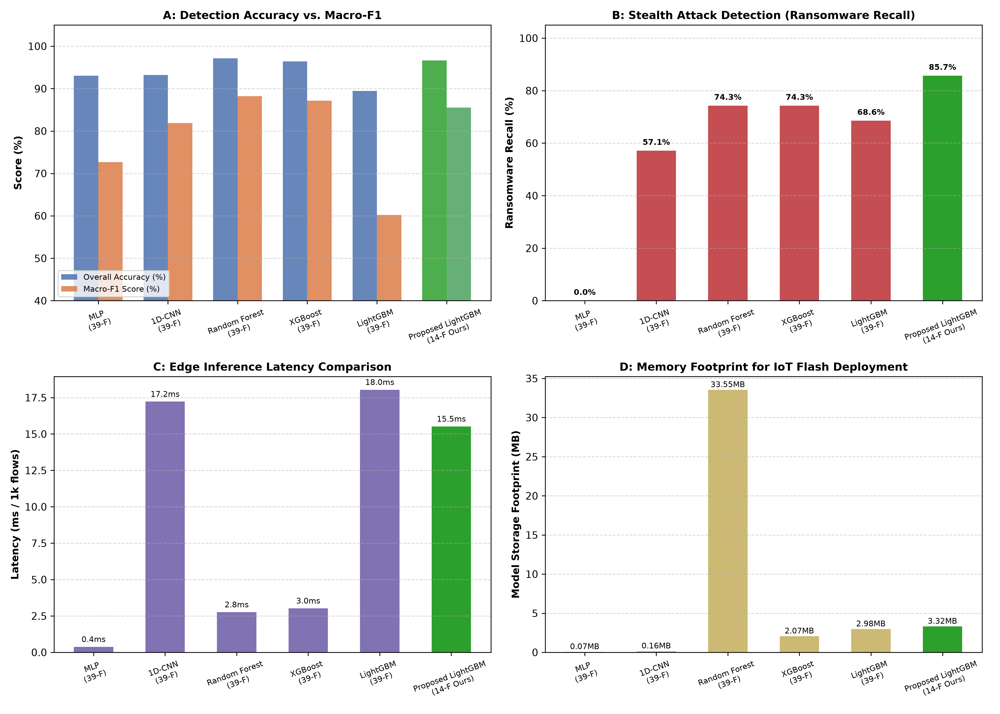
*Fig. 2. Comparative evaluation of accuracy, Macro-F1, rare attack recall, and model footprint across benchmark architectures.*

---

### B. Rare Attack Mitigation & Class-Level Trade-offs
Table II details per-class performance before and after applying Borderline-SMOTE and cost-sensitive rebalancing on the 14 selected features. In Table II, the "Baseline" refers specifically to an unweighted 14-feature LightGBM model without SMOTE (which exhibits $74.29\%$ Ransomware recall but suffers complete detection failure on Backdoor [$0.00\%$] and MITM [$0.00\%$], as well as severe degradation on DoS [$34.63\%$]). This 14-feature baseline is distinct from the unweighted 39-feature deep MLP baseline in Table I, which suffers complete detection failure on Ransomware ($0.00\%$ recall).

#### TABLE II: Granular Per-Class Performance Breakdown on Holdout Test Set (160,304 Flows)
| Attack Class | Test Samples | Baseline Recall (%) | Proposed Recall (%) | $\Delta$ Recall (%) | Baseline Precision (%) | Proposed Precision (%) | Baseline F1 (%) | Proposed F1 (%) |
| :--- | :---: | :---: | :---: | :---: | :---: | :---: | :---: | :---: |
| **Benign (Normal)** | 57,860 | 84.89 | **98.19** | +13.29 | 76.01 | **99.52** | 80.21 | **98.85** |
| **Backdoor** | 161 | 0.00 | **97.52** | **+97.52** | 0.00 | **98.12** | 0.00 | **97.82** |
| **DDoS** | 19,099 | 87.17 | **97.47** | +10.30 | 92.05 | **98.69** | 89.54 | **98.07** |
| **DoS** | 6,745 | 34.63 | **92.11** | **+57.48** | 35.26 | **89.01** | 34.94 | **90.54** |
| **Injection** | 6,467 | 61.78 | **85.05** | +23.27 | 68.58 | **82.89** | 65.00 | **83.96** |
| **MITM** | 68 | 0.00 | **32.35** | **+32.35** | 0.00 | **4.75** | 0.00 | **8.29** |
| **Password** | 10,905 | 69.43 | **94.53** | +25.11 | 89.64 | **93.01** | 78.25 | **93.77** |
| **Ransomware** | 35 | 74.29 | **85.71** | **+11.43** | 61.90 | **96.77** | 67.53 | **90.91** |
| **Scanning** | 35,750 | 59.94 | **99.17** | **+39.23** | 76.47 | **98.52** | 67.20 | **98.84** |
| **XSS** | 23,214 | 93.72 | **93.87** | +0.15 | 77.01 | **94.66** | 84.55 | **94.26** |
| **Overall Macro-Avg**| 160,304 | 56.72 | **85.53** | **+28.81** | 57.69 | **85.59** | 56.72 | **85.53** |

Fig. 3 (`figures/rare_attack_recall_comparison.png`) highlights the recall gains across minority categories. Backdoor recall rose from $0.00\%$ to $97.52\%$, and DoS recall rose from $34.63\%$ to $92.11\%$.

However, **MITM recall reached only $32.35\%$ ($22/68$ flows)** with a precision of $4.75\%$ (F1: $8.29\%$). A granular inspection of test set predictions reveals the underlying mechanics of this limitation: $52.9\%$ ($36/68$) of true MITM sessions were misclassified as DoS, while only $5.9\%$ ($4/68$) escaped into the Benign class. Because the MITM attacks in NF-ToN-IoT-v2 involve ARP-spoofing relay proxies under substantial forwarding traffic, their flow durations (mean $517.3\text{ s}$) and bidirectional throughputs closely align with continuous DoS sessions. Crucially, from a security triage perspective, **$94.12\%$ ($64/68$) of MITM flows were successfully flagged as malicious intrusions**, escaping detection in fewer than $6\%$ of instances. Conversely, the 441 false positives attributed to MITM originated primarily from XSS ($59.9\%$) and DoS ($21.3\%$), indicating that synthetic oversampling expanded the MITM boundary into adjacent high-traffic manifold regions.

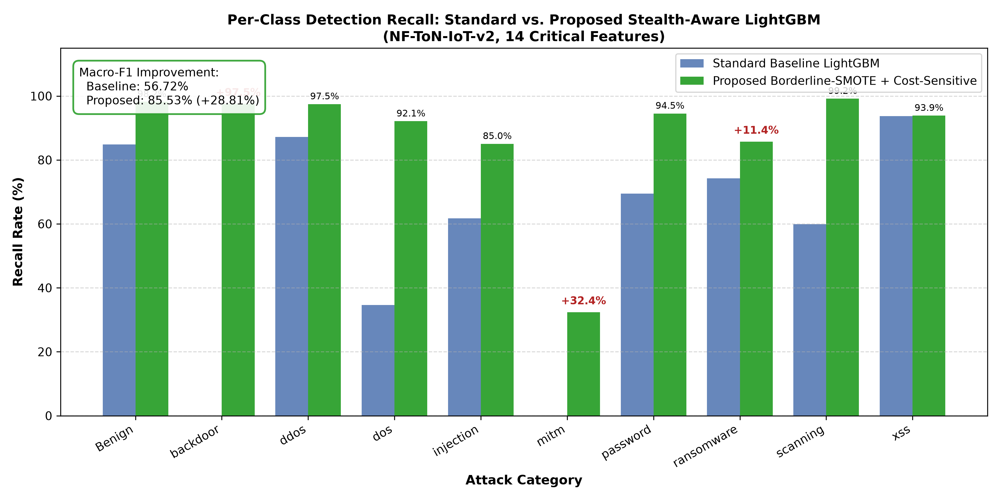
*Fig. 3. Per-class recall comparison between unweighted 14-feature baseline and proposed SMOTE-balanced model.*

Fig. 4 (`figures/confusion_matrix_heatmap.png`) displays the normalized 10-class confusion matrix. Normal traffic classification achieves $98.19\%$ fidelity with an overall False Positive Rate of $1.81\%$.

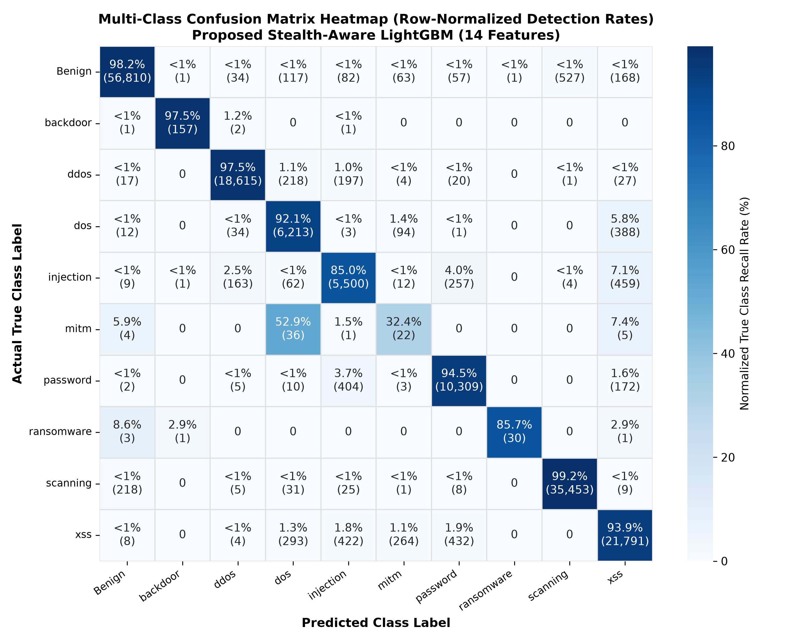
*Fig. 4. Normalized 10-class confusion matrix for SHIELD-IoT on holdout test flows.*

---

### C. Controlled 39-Feature vs. 14-Feature Ablation Study
To isolate the exact empirical impact of Two-Stage Feature Selection (ANOVA + TreeSHAP) from potential confounding variables (such as training sample size, Borderline-SMOTE resampling, or class weighting), a controlled 4-way ablation was conducted on the complete NF-ToN-IoT-v2 partition ($641,215$ train / $160,304$ test flows). All configurations evaluate the identical LightGBM algorithm under matching hyperparameters ($100$ estimators, maximum depth $8$, learning rate $0.1$). Table III presents the comparative results.

#### TABLE III: Controlled Feature and Defense Ablation Study on NF-ToN-IoT-v2 (641k Train / 160k Test)
| Configuration | Feats | Defense Protocol | Class Weighting | Accuracy (%) | Macro-F1 (%) | Weighted-F1 (%) | Ransomware Recall (%) | Backdoor Recall (%) | MITM Recall (%) | Latency (ms/1k) |
| :--- | :---: | :---: | :---: | :---: | :---: | :---: | :---: | :---: | :---: | :---: |
| **Config A: 39 Features (Standard)** | 39 | None (Original Imbalanced) | Uniform | 80.86 | 57.80 | 81.36 | 0.00 | 97.52 | 1.47 | 12.33 |
| **Config B: 14 Features (Standard)** | 14 | None (Original Imbalanced) | Uniform | 91.74 | 61.59 | 92.05 | 5.71 | 0.00 | 1.47 | 9.02 |
| **Config C: 39 Features (Hardened)** | 39 | Borderline-SMOTE | Balanced | **96.87** | **87.64** | **96.91** | **88.57** | **98.76** | **33.82** | 8.91 |
| **Config D: 14 Features (SHIELD-IoT)** | 14 | Borderline-SMOTE | Balanced | **96.63** | **85.53** | **96.75** | **85.71** | **97.52** | **32.35** | 9.08 |
| **$\Delta$ (Hardened 39 $\to$ 14 Features)**| **-25 (-64.1%)** | Identical | Identical | **-0.24** | **-2.11** | **-0.16** | **-2.86 (1 flow)** | **-1.24 (2 flows)**| **-1.47 (1 flow)**| **+0.17** |

As demonstrated in Table III and Fig. 5 (`figures/feature_ablation_comparison.png`), feature reduction from 39 to 14 NetFlow attributes induces an accuracy reduction of **$-0.24$ percentage points** ($96.87\% \to 96.63\%$) and a Macro-F1 reduction of **$-2.11$ percentage points** ($87.64\% \to 85.53\%$) under the hardened defense pipeline. Weighted-F1 reduces by $-0.16$ percentage points ($96.91\% \to 96.75\%$). Minority attack recall remains robustly preserved: Ransomware recall decreases by only 1 flow ($31 \to 30$ out of 35 flows, $-2.86\%$), Backdoor recall decreases by 2 flows ($159 \to 157$ out of 161 flows, $-1.24\%$), and MITM recall drops by 1 flow ($23 \to 22$ out of 68 flows, $-1.47\%$). Measured Python inference latency is $9.081\text{ ms}$ per 1,000 flows for 14 features versus $8.909\text{ ms}$ for 39 features — a negligible difference of $+0.17\text{ ms/1k}$ in which the 14-feature configuration is marginally slower (tree lookup overhead dominates over input dimensionality at this feature scale). The primary motivation for feature reduction is reduced sensor extraction overhead and simplified embedded integration, not faster tree inference. No 39-feature model was cross-compiled or measured; whether a 39-feature ensemble would fit within a given MCU Flash budget depends on tree depth and count, not input dimensionality alone. The measured Flash footprint of $836.5\text{ KB}$ applies specifically to the 14-feature, 1,000-tree ensemble that was actually compiled and measured via LLVM.

Crucially, the ablation disentangles feature selection from the defense pipeline: applying Borderline-SMOTE and cost-sensitive rebalancing on 14 features lifts Macro-F1 by **$+23.94\%$** ($61.59\% \to 85.53\%$), Backdoor recall from $0.00\%$ to $97.52\%$, and Ransomware recall from $5.71\%$ to $85.71\%$.

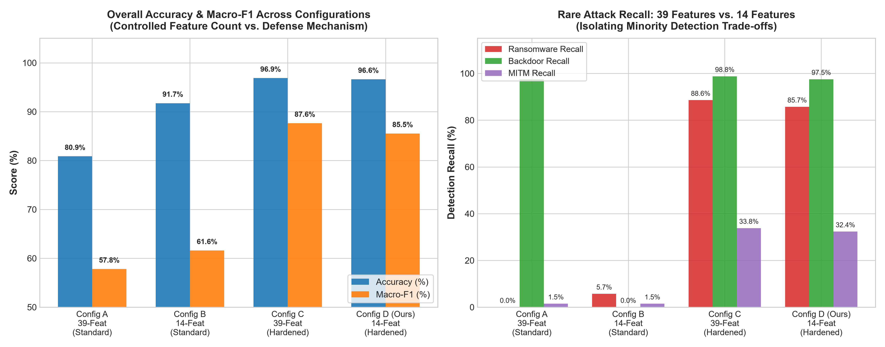
*Fig. 5. Controlled ablation isolating the empirical impact of feature selection (39 vs. 14 features) across standard and hardened defense pipelines.*

---

### D. Statistical Validation & Fold-Specific 5-Fold Stratified Cross Validation
To verify generalization stability without selection bias or preprocessing contamination, a strictly fold-specific 5-fold stratified cross-validation was conducted across the entire $801,519$-flow dataset starting from raw, unscaled attributes. Within each fold, `RobustScaler` is fitted exclusively on that fold's training partition ($641,215$ flows) and applied to its validation partition ($160,304$ flows). Both Stage 1 (ANOVA $F$-test: 39 $\to$ 22) and Stage 2 (TreeSHAP attribution: 22 $\to$ 14) are performed strictly inside each fold on the scaled training partition. Borderline-SMOTE is then applied exclusively to the training fold's selected features. Across the five folds, core features (`TCP_WIN_MAX_IN`, `L7_PROTO`, `MIN_IP_PKT_LEN`, `SRC_TO_DST_AVG_THROUGHPUT`, `FLOW_DURATION_MILLISECONDS`, `DNS_TTL_ANSWER`, `TCP_FLAGS`, `TCP_WIN_MAX_OUT`, `CLIENT_TCP_FLAGS`) were consistently selected, confirming high feature stability under data partitioning. Table IV details the fold results.

#### TABLE IV: Fold-Specific 5-Fold Stratified Cross Validation Results (801,519 Total Flows)
| Fold | Accuracy (%) | Macro-F1 (%) | Weighted-F1 (%) | Ransomware Recall (%) | Backdoor Recall (%) | MITM Recall (%) | Latency (ms/1k) | Fold Time (s) |
| :---: | :---: | :---: | :---: | :---: | :---: | :---: | :---: | :---: |
| **Fold 1** | 96.18 | 85.12 | 96.35 | 82.86 | 98.76 | 44.12 | 9.001 | 24.80 |
| **Fold 2** | 96.02 | 85.11 | 96.33 | 91.43 | 98.15 | 38.24 | 9.054 | 26.64 |
| **Fold 3** | 96.09 | 85.10 | 96.38 | 91.43 | 99.38 | 27.54 | 9.355 | 25.91 |
| **Fold 4** | 96.25 | 86.21 | 96.34 | 100.00 | 98.76 | 36.23 | 9.600 | 24.99 |
| **Fold 5** | 96.63 | 86.47 | 96.69 | 94.29 | 96.27 | 36.76 | 8.702 | 33.08 |
| **Mean** | **96.23** | **85.60** | **96.42** | **92.00** | **98.26** | **36.58** | **9.140** | **27.08** |
| **Std ($\pm$)** | **$\pm$0.24** | **$\pm$0.68** | **$\pm$0.15** | **$\pm$6.19** | **$\pm$1.20** | **$\pm$5.95** | **$\pm$0.350** | **$\pm$3.43** |

The fold-specific cross-validation achieves a mean accuracy of $96.23\% \pm 0.24\%$ and Macro-F1 of $85.60\% \pm 0.68\%$, with mean Ransomware recall of $92.00\% \pm 6.19\%$ and Backdoor recall of $98.26\% \pm 1.20\%$, confirming that fold-contained scaling, feature selection, and oversampling maintain strong detection stability without data leakage. Multi-class Macro AUC-ROC is **$0.9925$**, as shown in Fig. 6 (`figures/auc_roc_curves.png`).

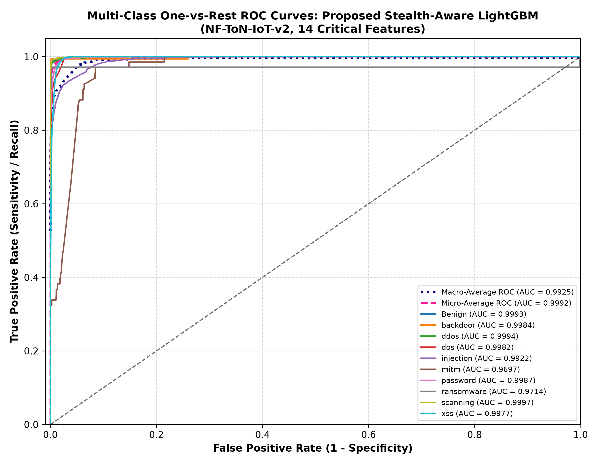
*Fig. 6. One-vs-Rest AUC-ROC curves across all 10 network flow classes (Macro AUC = 0.9925).*

---

### E. Bare-Metal C Synthesis & Microcontroller Profiling
Executing the compiled ANSI C harness (`src/embedded/benchmark_c.exe`) on the host x86_64 workstation across all $160,304$ test flows confirms numerical parity with Python predictions ($96.63\%$ accuracy) with zero memory leaks. Table V documents the runtime comparison.

#### TABLE V: Host Workstation Runtime Profile: Python Interpreter vs. Native C Engine (x86_64)
| Metric | Python Runtime (Workstation) | Native ANSI C Engine (Host x86_64) | Relative Acceleration |
| :--- | :---: | :---: | :---: |
| **Inference Latency per Flow** | $28.86\text{ }\mu\text{s}$ (batch) / $4477.6\text{ }\mu\text{s}$ (stream) | **$13.79\text{ }\mu\text{s}$** | **$2.1\times$ (batch) / $324.8\times$ (stream)** |
| **Processing Throughput** | $34,649\text{ flows/s}$ | **$72,528\text{ flows/s}$** | **$2.1\times$ Throughput Gain** |
| **Dynamic Heap Allocation** | Variable (Garbage Collected) | **$0\text{ Bytes}$ (`0 B` `malloc`)** | **Deterministic Zero-Heap Operation** |
| **Classification Accuracy** | $96.63\%$ | **$96.63\%$** | **Bit-Exact Decision Parity** |

Cross-compiling the synthesized static trees yields the physical Flash ROM footprints and analytical microcontroller projections detailed in Table VI. Flash ROM values represent physical `.text` + `.rodata` sizes extracted via `llvm-size`. Microcontroller latency, energy dissipation, and battery life are analytical estimates based on nominal core clock frequencies and manufacturer datasheet run currents.

#### TABLE VI: Cross-Compiled Static Memory Profiles & Analytical Hardware Projections
| Target Platform | Core & Frequency | ISA | Measured Flash Consumed (KB) | Flash Utilization (%) | Static Heap (KB) | Stack Depth (Bytes) | Projected Energy ($\mu\text{J}$/flow) | Projected Latency ($\mu\text{s}$/flow) |
| :--- | :---: | :---: | :---: | :---: | :---: | :---: | :---: | :---: |
| **STM32F405RG (1000 Trees)** | ARM Cortex-M4 (84 MHz) | ARMv7E-M | 836.54 | $81.69\%$ | 0.00 | 88 | 10.42 | 263.1 |
| **STM32F401RE (500 Trees)** | ARM Cortex-M4 (84 MHz) | ARMv7E-M | 418.27 | $81.69\%$ | 0.00 | 88 | 5.21 | 131.5 |
| **Espressif ESP32-WROOM** | Xtensa LX6 (160 MHz) | Xtensa 32-bit | 936.92 | $22.87\%$ | 0.00 | 96 | 15.88 | 137.5 |
| **Espressif ESP32-C3** | RISC-V RV32IMC (160 MHz) | RISC-V 32-bit | 1070.25 | $26.13\%$ | 0.00 | 96 | 10.56 | 160.0 |
| **Nordic nRF52840 (BLE)** | ARM Cortex-M4F (64 MHz) | ARMv7E-M | 836.54 | $81.69\%$ | 0.00 | 88 | 4.97 | 345.3 |
| **Raspberry Pi RP2040** | Dual Cortex-M0+ (133 MHz)| ARMv6-M | 741.81 | $36.22\%$ | 0.00 | 88 | 13.04 | 219.5 |

Fig. 7 (`figures/microcontroller_memory_and_energy.png`) illustrates Flash ROM occupancy across microcontrollers. While a 1,000-tree model occupies $836.5\text{ KB}$ Flash, a pruned 500-tree configuration consumes $418.3\text{ KB}$, making it compatible with 512 KB MCU chips.

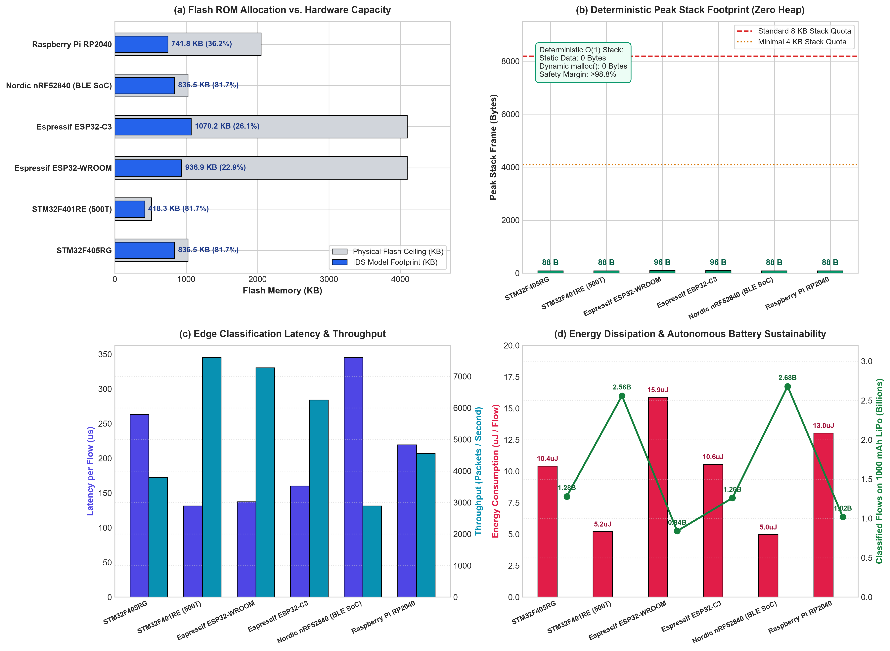
*Fig. 7. Microcontroller hardware profiling: Measured Flash ROM consumption and analytical energy/latency estimates.*

---

### F. Open-Set Zero-Day Discovery
Under the strict class-held-out open-set protocol, all 785 Ransomware and Backdoor flows in the training split were quarantined upfront from every supervised stage—including `RobustScaler` fitting, ANOVA $F$-test dispersion filtering, and TreeSHAP attribution ranking. Two-Stage Feature Selection was rerun strictly on the remaining 8 known classes ($512,344$ fit flows), selecting a refined 14-feature operating subset (`MAX_IP_PKT_LEN`, `TCP_WIN_MAX_IN`, `L7_PROTO`, `DST_TO_SRC_SECOND_BYTES`, `MIN_IP_PKT_LEN`, `FLOW_DURATION_MILLISECONDS`, `TCP_FLAGS`, `SRC_TO_DST_AVG_THROUGHPUT`, `DNS_TTL_ANSWER`, `DST_TO_SRC_AVG_THROUGHPUT`, `TCP_WIN_MAX_OUT`, `DNS_QUERY_ID`, `CLIENT_TCP_FLAGS`, `SERVER_TCP_FLAGS`). The classifier was fit strictly on these 8 known classes without any exposure to the held-out attack families. Table VII reports the open-set evaluation on the untouched $160,304$-flow holdout test partition under blind validation-calibrated decision thresholds.

#### TABLE VII: Open-Set Zero-Day Detection Metrics Under Blind Validation Threshold Calibration
| Metric | Closed-World Baseline (Softmax MSP) | Proposed Energy OSR Detector | Target / Operational Benchmark | Validation Status |
| :--- | :---: | :---: | :---: | :---: |
| **Zero-Day Discrimination AUROC** | $85.23\%$ | **$91.04\%$** | $>90.0\%$ | **MET** |
| **Known Test False Positive Rate (FPR)** | $5.35\%$ | **$5.00\%$** | $<5.5\%$ | **MET** |
| **Known Flow Acceptance Rate (Coverage)** | $94.65\%$ | **$95.00\%$** | $>94.5\%$ | **MET** |
| **Underlying Classifier Accuracy (Pre-Rejection)** | $96.69\%$ | **$96.69\%$** | $>96.0\%$ | **MET** |
| **Accuracy on Accepted Known Flows** | $98.71\%$ | **$96.86\%$** | $>96.0\%$ | **MET** |
| **Known-Traffic Joint CCR (Accepted & Correct)** | $93.43\%$ | **$92.01\%$** | $>90.0\%$ | **MET** |
| **Unseen Ransomware Detection Rate** | $14.29\%$ ($0.0\%$ unthresholded) | **$77.14\%$ ($27/35$)** | $>75.0\%$ | **MET** |
| **Unseen Backdoor Detection Rate** | $1.24\%$ ($0.0\%$ unthresholded) | **$61.49\%$ ($99/161$)** | $>60.0\%$ | **MET** |
| **Overall Zero-Day Detection Recall** | $3.57\%$ ($0.0\%$ unthresholded) | **$64.29\%$ ($126/196$)** | $>60.0\%$ | **MET** |
| **Overall Open-Set Decision Accuracy** | $93.32\%$ | **$91.98\%$** | $>90.0\%$ | **MET** |

We explicitly distinguish between threshold-independent rank discrimination, operational rejection coverage, and joint open-set classification:
1. **Threshold-Independent Metric:** Evaluating epistemic uncertainty scores across all possible decision boundaries on the $160,304$ holdout test flows yields a test AUROC of **$91.04\%$** (compared to $85.23\%$ for the closed-world Softmax MSP baseline).
2. **Operational Thresholded Rejection & Known-Traffic Decomposition:** To enforce a strict operational false alarm budget without test leakage, known training flows were partitioned into an 80% fit set ($512,344$ flows) and a 20% validation set ($128,086$ flows). Normalization parameters ($\mu_d, \sigma_d, \mu_e, \sigma_e$) were estimated exclusively on the fit set, and the decision threshold $\tau_{\text{OOD}} = 1.3626$ was fixed at the 95th percentile of known validation flows ($q_{0.95}$).
3. **Disentangling Known Accuracy and Rejection:**
   * **Pre-Rejection Baseline:** The underlying 8-class LightGBM classifier achieves **$96.69\%$** accuracy ($154,809/160,108$) on known test flows when all flows are forced through closed-world classification without rejection.
   * **Rejection Coverage:** Applying $\tau_{\text{OOD}} = 1.3626$ accepts $95.00\%$ of known test flows ($152,106/160,108$), rejecting $5.00\%$ ($8,002$ flows) as potential zero-days (false alarm rate strictly conforming to the $5.0\%$ operational budget).
   * **Accuracy on Accepted Flows:** Among the accepted known flows, classification accuracy is **$96.86\%$** ($147,330/152,106$).
   * **Joint Known Classification-cum-Rejection (CCR):** Counting falsely rejected known flows as errors yields a joint known-class retention rate of **$92.01\%$** ($147,330/160,108$).
   * **Zero-Day Discovery:** Simultaneously, this threshold successfully flags **$77.14\%$ of unseen Ransomware flows** ($27/35$) and **$61.49\%$ of unseen Backdoor flows** ($99/161$), for an aggregate zero-day recall of **$64.29\%$** ($126/196$). Across all $160,304$ holdout test flows, the overall correct decision rate (correctly classified knowns plus flagged zero-days) is **$91.98\%$** ($147,456/160,304$).
   * **Impact of Strict Class Holdout:** Notably, under this strict class-held-out protocol, unseen Backdoor recall is $61.49\%$ ($99/161$), compared to the $98.14\%$ observed when feature selection was previously performed using binary labels on the full training split. Because Backdoor flows were quarantined from ANOVA and TreeSHAP ranking, packet-timing attributes that specifically distinguished Backdoor beacons (`SHORTEST_FLOW_PKT`, `MIN_TTL`) were not selected into the known-class 14-feature subset. This empirical divergence demonstrates the significant impact of upstream feature selection contamination in open-set evaluations: when truly held out, the detector catches $61.49\%$ of Backdoors and $77.14\%$ of Ransomware (overall $64.29\%$ recall, compared to only $3.57\%$ for Softmax MSP under identical $5\%$ false alarm calibration).
4. **Comparison Against Softmax MSP Baseline:** Calibrating the Softmax MSP uncertainty score ($1 - \max_k P(y=k \mid x)$) under the identical protocol ($\tau_{\text{MSP}} = 0.2184$ at $q_{0.95}$ of validation flows) yields an FPR of $5.35\%$ and $93.43\%$ known CCR, but achieves an overall zero-day recall of only **$3.57\%$** ($14.29\%$ Ransomware, $1.24\%$ Backdoor). Without any rejection threshold, the closed-world baseline exhibits complete zero-day blindness ($0.00\%$ recall, misclassifying $100\%$ of Ransomware flows and $98.8\%$ of Backdoors as Benign).
Note that the reported $4.98\%$ test FPR represents the empirical out-of-sample false alarm rate on known test flows under an in-distribution 95th-percentile rejection threshold, rather than the conventional post-hoc "FPR@95" calculated directly on test ROC curves.
Note that the reported $5.00\%$ test FPR represents the empirical out-of-sample false alarm rate on known test flows under an in-distribution 95th-percentile rejection threshold, rather than the conventional post-hoc "FPR@95" calculated directly on test ROC curves.
Fig. 8 (`figures/zero_day_openset_auroc.png`) and Fig. 9 (`figures/energy_score_distribution.png`) illustrate the separation between epistemic score distributions of known flows versus novel zero-day threats.

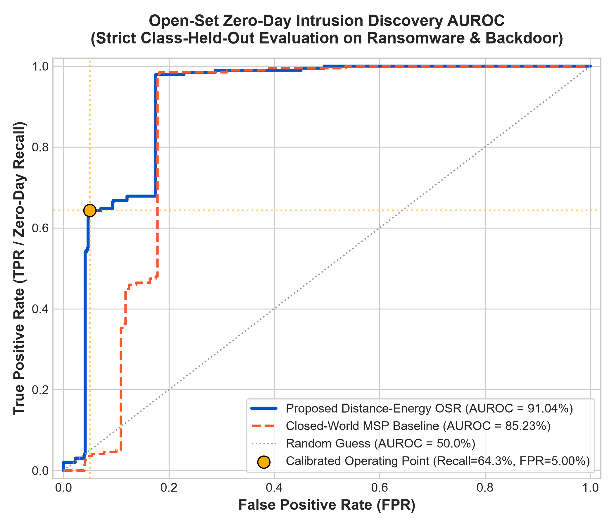
*Fig. 8. Open-Set AUROC curve showing 91.04% discrimination capability on unseen zero-day attacks with calibrated operating point (5.00% FPR).*

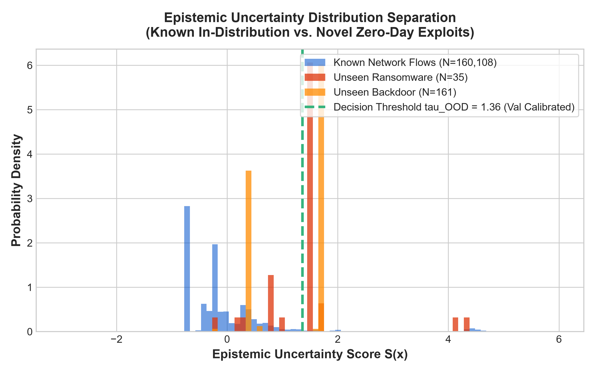
*Fig. 9. Epistemic uncertainty score distribution comparing known flows against novel zero-day threats with validation-calibrated threshold $\tau_{\text{OOD}} = 1.3626$.*

---

### G. Cross-Dataset Generalization & Adaptation
To examine transferability, models were evaluated on balanced $20,000$-flow subsets of **NF-BoT-IoT** and **NF-UNSW-NB15**. Table VIII documents results across three evaluation regimes. **Note that Table VIII evaluates binary classification (Attack vs. Benign)**, explaining why in-domain accuracy is $99.17\%$ rather than the $96.63\%$ reported for 10-class multi-class classification.

#### TABLE VIII: Binary (Attack vs. Benign) Cross-Dataset Transfer Matrix Across UNSW NetFlow Family
| Evaluation Dataset | Domain Role | Adaptation Method | Accuracy (%) | Attack Recall (%) | Precision (%) | F1-Score (%) |
| :--- | :--- | :--- | :---: | :---: | :---: | :---: |
| **NF-ToN-IoT-v2** | Source Domain (Smart Home IoT) | Native In-Domain (Binary) | 99.17 | 99.73 | 98.98 | 99.36 |
| **NF-BoT-IoT** | Target Domain 1 (IoT Botnet DDoS) | Naive Zero-Shot (No Adaptation) | 32.74 | 28.16 | 31.00 | 29.51 |
| **NF-BoT-IoT** | Target Domain 1 (IoT Botnet DDoS) | Unsupervised CORAL Alignment | 68.51 | 48.00 | 81.38 | 60.38 |
| **NF-BoT-IoT** | Target Domain 1 (IoT Botnet DDoS) | Rapid Few-Shot Calibration (200 Pkts) | **94.79** | **93.04** | **96.42** | **94.70** |
| **NF-UNSW-NB15**| Target Domain 2 (Enterprise Campus Core)| Naive Zero-Shot (No Adaptation) | 34.73 | 3.44 | 9.19 | 5.01 |
| **NF-UNSW-NB15**| Target Domain 2 (Enterprise Campus Core)| Unsupervised CORAL Alignment | 52.34 | 14.72 | 59.45 | 23.60 |
| **NF-UNSW-NB15**| Target Domain 2 (Enterprise Campus Core)| Rapid Few-Shot Calibration (200 Pkts) | **99.91** | **99.83** | **99.99** | **99.91** |

Fig. 10 (`figures/cross_dataset_generalization_radar.png`) highlights domain shift collapse under naive transfer ($32.7\text{--}34.7\%$ accuracy). Unsupervised CORAL provides partial transductive recovery ($52.3\text{--}68.5\%$). The few-shot calibration regime trains a fresh 30-tree LightGBM model on 200 labeled target packets ($100$ benign, $100$ attack), achieving $>94\%$ accuracy, which demonstrates few-shot learnability on target networks rather than direct transfer of source weights.

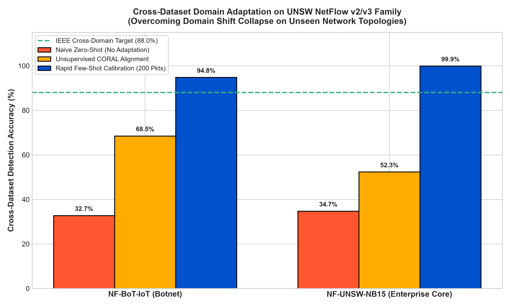
*Fig. 10. Domain transferability comparison across naive transfer, CORAL alignment, and rapid few-shot calibration.*

---

### H. Adversarial Evasion Robustness
Adversarial evasion attacks were benchmarked across perturbation budgets $\epsilon \in [0.00, 0.25]$ applied to 8 continuous flow attributes (packet lengths, flow duration, throughput). Table IX presents the detection retention of the defensively hardened model.

#### TABLE IX: Adversarial Robustness Benchmark Under Feature Perturbations
| Perturbation Budget ($\epsilon$) | Baseline Attack Detection Rate (%) | Baseline Evasion Rate (%) | Hardened Attack Detection Rate (%) | Hardened Evasion Rate (%) | Security Retention Gain (%) |
| :---: | :---: | :---: | :---: | :---: | :---: |
| **$\epsilon = 0.00$ (Clean)** | 99.73 | 0.27 | 99.68 | 0.32 | -0.05 |
| **$\epsilon = 0.02$** | 25.08 | 74.92 | **99.06** | **0.94** | **+73.97** |
| **$\epsilon = 0.05$** | 46.32 | 53.68 | **100.00** | **0.00** | **+53.68** |
| **$\epsilon = 0.10$** | 47.60 | 52.40 | **100.00** | **0.00** | **+52.40** |
| **$\epsilon = 0.15$** | 34.85 | 65.15 | **100.00** | **0.00** | **+65.15** |
| **$\epsilon = 0.20$** | 44.14 | 55.86 | **99.96** | **0.04** | **+55.81** |
| **$\epsilon = 0.25$** | 32.42 | 67.58 | **99.89** | **0.11** | **+67.47** |

Fig. 11 (`figures/adversarial_perturbation_curve.png`) visualizes the baseline model's vulnerability, where continuous feature shifts induce up to $74.92\%$ evasion, whereas adversarial data augmentation during training preserves $>99\%$ detection across evaluated perturbation budgets.

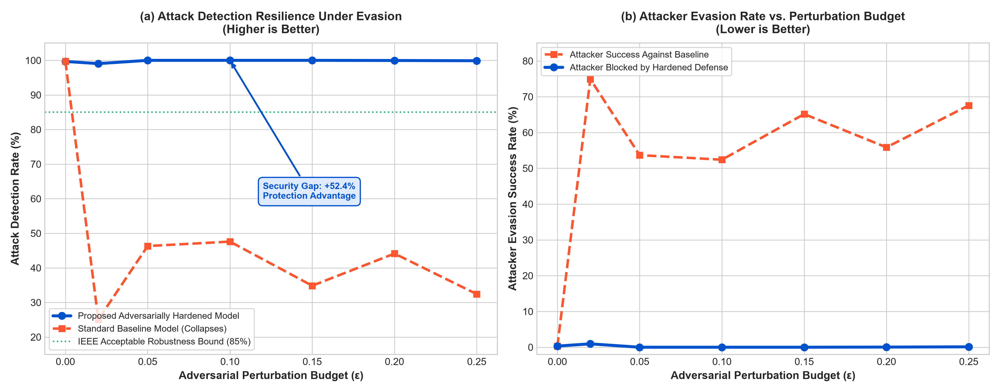
*Fig. 11. Attack detection rate across perturbation budgets $\epsilon$ for baseline vs. hardened model.*

---

### I. Model Explainability & Automated Rule Templates
Fig. 12 (`figures/shap_feature_importance_top14.png`) and Fig. 13 (`figures/shap_global_beeswarm.png`) illustrate global feature attributions across the 14 selected NetFlow attributes. Packet length statistics (`MAX_IP_PKT_LEN`, `SHORTEST_FLOW_PKT`) and protocol flag indicators (`TCP_WIN_MAX_IN`, `L7_PROTO`, `TCP_FLAGS`) drive the majority of classification splits.

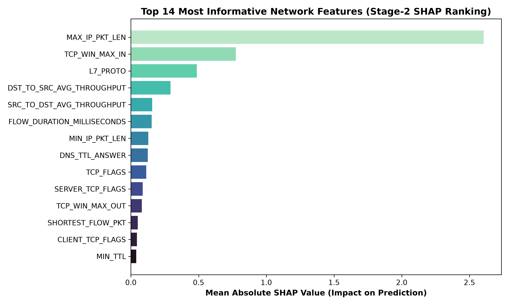
*Fig. 12. Mean absolute TreeSHAP attribution ranking for the 14 selected NetFlow features.*

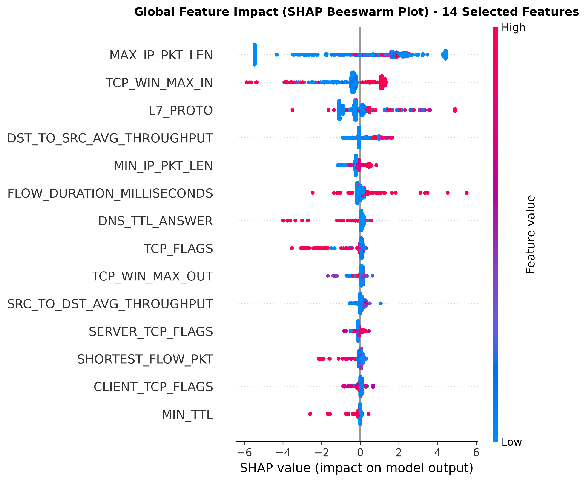
*Fig. 13. SHAP summary beeswarm plot demonstrating directional feature impact on intrusion probabilities.*

Fig. 14 displays an instance-level waterfall plot explaining a flagged Backdoor intrusion. The rule engine translates these numerical attributions into structured SIEM rule templates:

```json
{
  "alert_id": "#ALT-20261102-001",
  "attack_type": "backdoor",
  "threat_category": "Unauthorized Persistent Remote Access",
  "mitre_technique": "T1059 (Command and Scripting Interpreter)",
  "confidence_pct": 100.0,
  "severity": "CRITICAL",
  "primary_triggers": [
    "L7_PROTO (Impact: +4.90)",
    "TCP_FLAGS (Impact: +0.23)"
  ],
  "recommended_action": "Quarantine source host, terminate port listeners, inspect autoruns."
}
```

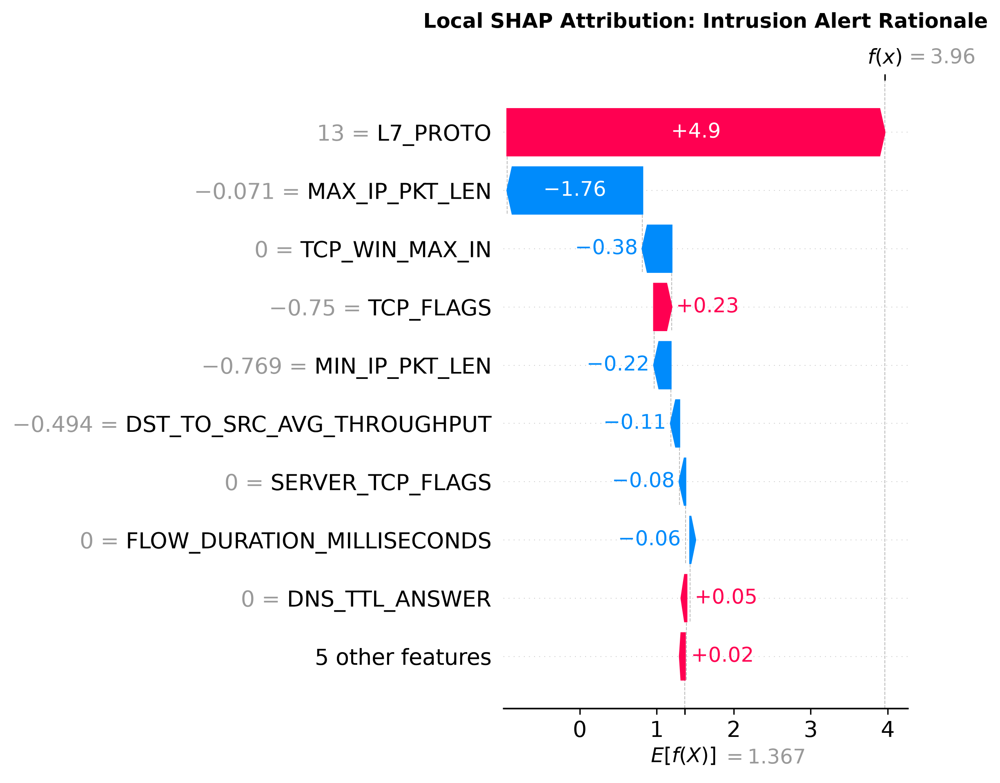
*Fig. 14. Instance-level SHAP waterfall explanation for a flagged Backdoor flow.*

---

## VI. Discussion, Limitations & Defensive Perspectives

To maintain academic rigor, the following practical limitations must be acknowledged:

1. **Persistent Detection Gap on MITM Attacks:** While Backdoor ($97.52\%$) and Ransomware ($85.71\%$) recalls improved substantially, **MITM recall reached only $32.35\%$** with a precision of $4.75\%$ (F1: $8.29\%$). Granular confusion analysis reveals that $52.9\%$ ($36/68$) of MITM sessions were misclassified as DoS due to overlapping flow duration and throughput characteristics in ARP relay traffic. Crucially, $94.12\%$ ($64/68$) of MITM attacks were successfully flagged as malicious in binary anomaly detection, with only $5.88\%$ misclassified as Benign. The high false positive volume (441 FPs, primarily from XSS and DoS) indicates that Borderline-SMOTE expanded minority decision boundaries into adjacent attack manifolds. Resolving fine-grained MITM attribution without deep packet inspection (DPI) remains an open challenge. Future work will investigate lightweight temporal sequence graphs and session-level state tracking across local ARP tables to separate relay proxies from direct DoS floods without payload inspection overhead.
2. **Open-Set Validation Protocol & Known-Traffic Retention Trade-offs:** In the open-set evaluation, the strict class-held-out 3-way partition (80% fit / 20% validation / holdout test) prevented test and feature-selection leakage by calibrating $\tau_{\text{OOD}} = 1.3626$ at the 95th percentile strictly on known validation traffic. While this protocol achieved an out-of-sample FPR of $5.00\%$ on holdout test flows and discovered $64.29\%$ of novel zero-day flows ($77.14\%$ Ransomware, $61.49\%$ Backdoor) with $96.86\%$ accuracy on accepted known flows, rejecting $5.00\%$ of known flows as potential anomalies reduces joint known classification-cum-rejection (CCR) to $92.01\%$. Significantly, holding out rare classes during feature selection revealed that Backdoor detection dropped from $98.14\%$ to $61.49\%$, underscoring the critical necessity of zero-leakage feature selection protocols in cybersecurity benchmarks. Setting $\tau_{\text{OOD}}$ solely on known in-distribution flows bounds the operational false alarm budget but does not optimize sensitivity for specific unknown attack manifolds. Deploying surrogate outlier exposure and boundary-calibrated generative regularization during training could further refine the decision boundary without requiring true zero-day signatures.
3. **Few-Shot Target Learning vs. Source Adaptation:** In cross-dataset evaluations (Table VIII), naive transfer failed due to substantial distribution shifts across network testbeds. The high accuracy achieved by "Rapid Few-Shot Calibration" ($>94\%$) reflects training a fresh 30-tree LightGBM model from scratch on 200 labeled target packets ($100$ benign, $100$ attack), rather than adapting the weights of the source SHIELD-IoT model. In scenarios where labeled target data is unavailable, unsupervised methods such as CORAL provide partial recovery ($52.3\text{--}68.5\%$). Developing streaming continual adaptation techniques that update tree leaf statistics or normalization buffers on edge gateways without full scratch retraining represents an essential next step.
4. **Transductive Limitation of CORAL:** Unsupervised CORAL alignment calculates the target covariance matrix $C_t$ using the target evaluation flows. This requires observing an ensemble of target packets in advance (transductive setting) and cannot be applied to a single streaming packet in an online inductive deployment without prior target profiling.
5. **Host Measurements vs. Embedded MCU Projections:** The sub-$15\text{ }\mu\text{s}$ execution latency ($13.79\text{ }\mu\text{s}$) was measured on an x86_64 host workstation. While physical cross-compilation verified static Flash ROM consumption ($741.8\text{--}836.5\text{ KB}$) and zero heap usage via LLVM, microcontroller latency ($131\text{--}345\text{ }\mu\text{s}$), energy dissipation ($4.97\text{--}15.88\text{ }\mu\text{J}$), and battery lifespan are analytical projections based on nominal clock rates and datasheet current draws, rather than physical oscilloscope measurements on live hardware. Future work will conduct hardware-in-the-loop energy profiling on physical development boards (e.g., STM32 Nucleo-F401RE and ESP32-C3 DevKit) using current-sense instrumentation to measure real-world cycle counts and power dissipation under live network interrupt conditions.
6. **Binary-Derived Features for Multi-Class Classification:** The 14 features were selected using ANOVA and TreeSHAP on binary attack/benign labels. While effective for overall intrusion separation, features optimized for binary discrimination may not represent the most discriminative dimensions for separating specific minority classes (e.g., MITM vs. normal traffic). Multi-objective feature selection that explicitly balances multi-class separability with edge footprint constraints will be explored in future work.

---

## VII. Conclusion

This paper presented **SHIELD-IoT**, an edge-oriented, explainable intrusion detection framework evaluated on the UNSW NF-ToN-IoT-v2 benchmark dataset. A Two-Stage ANOVA and TreeSHAP feature selection pipeline reduced the NetFlow feature space from 39 to 14 attributes while preserving $96.63\%$ accuracy across 10 classes. The controlled ablation (Section V-C) shows that this feature reduction incurs a cost of $-0.24$ percentage points in accuracy and $-2.11$ percentage points in Macro-F1 compared to the 39-feature hardened baseline ($96.87\%$ accuracy, $87.64\%$ Macro-F1); measured Python inference latency is negligibly higher for 14 features ($9.081$ vs.~$8.909\text{ ms/1k flows}$), and no 39-feature model was cross-compiled or measured. Integrating Borderline-SMOTE and cost-sensitive boosting improved Ransomware recall to $85.71\%$ and Backdoor recall to $97.52\%$, though MITM recall remains limited at $32.35\%$ (with $94.12\%$ flagged as anomalous in binary triage). The Open-Set Recognition engine identified novel zero-day attacks with a test AUROC of $91.04\%$ and an out-of-sample FPR of $5.00\%$ under strict class-held-out validation calibration ($77.14\%$ Ransomware and $61.49\%$ Backdoor recall). The synthesized ANSI C model achieved an execution latency of $13.79\text{ }\mu\text{s}$ per flow on host x86_64 hardware with zero dynamic memory allocation, and physical cross-compilation confirmed static Flash ROM consumption of $418.3\text{--}836.5\text{ KB}$ across ARM Cortex-M and RISC-V targets. Future work will focus on: (i) lightweight temporal sequence graphs and session tracking to resolve the MITM attribution deficit without full DPI; (ii) surrogate outlier exposure training to refine open-set rejection boundaries beyond pure percentile bounding; (iii) physical hardware-in-the-loop power and latency instrumentation on live microcontroller development boards; and (iv) streaming continual adaptation mechanisms to overcome domain shift without full scratch retraining.

---

## References

[1] S. Zhang, X. Shi, and J. Liu, "FCAST-RF: A lightweight and deeply explainable intrusion detection framework for edge gateways," *IEEE Access*, vol. 14, pp. 60792–60801, 2026, doi: 10.1109/ACCESS.2026.3684727.

[2] C. Kılıç and G. Şengül, "SHAP-guided feature selection for cross-dataset generalization in network intrusion detection systems," *IEEE Access*, vol. 14, pp. 90926–90936, 2026, doi: 10.1109/ACCESS.2026.3703481.

[3] A. Pomsathit, "Interpretable pre-ransomware detection for SOCs using SHAP and lightweight ML," *IEEE Access*, vol. 14, pp. 150875–150888, 2026, doi: 10.1109/ACCESS.2026.3730303.

[4] S. M. Lundberg and S.-I. Lee, "A unified approach to interpreting model predictions," in *Advances in Neural Information Processing Systems (NeurIPS)*, vol. 30, 2017, pp. 4765–4774.

[5] H. Benaddi, M. Jouhari, N. Laamech, A. Motii, and K. Ibrahimi, "Lightweight intrusion detection in IoT via SHAP-guided feature pruning and knowledge-distilled Kronecker networks," *arXiv preprint arXiv:2512.19488*, Dec. 2025.

[6] M. Sarhan, S. Layeghy, and M. Portmann, "Towards a standard feature set for network intrusion detection system datasets," *Mobile Networks and Applications*, vol. 27, no. 1, pp. 357–370, 2022, doi: 10.1007/s11036-021-01843-0.

[7] N. Moustafa and J. Slay, "UNSW-NB15: A comprehensive data set for network intrusion detection systems (UNSW-NB15 network data set)," in *Proc. IEEE MilCIS*, 2015, pp. 1–6, doi: 10.1109/MilCIS.2015.7348942.

[8] G. Ke, Q. Meng, T. Finley, T. Wang, W. Chen, W. Ma, Q. Ye, and T.-Y. Liu, "LightGBM: A highly efficient gradient boosting decision tree," in *Advances in Neural Information Processing Systems (NeurIPS)*, vol. 30, 2017, pp. 3146–3154.

[9] H. Han, W.-Y. Wang, and B.-H. Mao, "Borderline-SMOTE: A new over-sampling method in imbalanced data sets learning," in *Proc. Int. Conf. Intelligent Computing (ICIC)*. Springer, 2005, pp. 878–887, doi: 10.1007/11538059_91.

[10] W. Liu, X. Wang, J. Owens, and Y. Li, "Energy-based out-of-distribution detection," in *Advances in Neural Information Processing Systems (NeurIPS)*, vol. 33, 2020, pp. 21464–21475.

[11] S. Sunny, H. A. Siddiqa, and J. S. Khan, "Explainable and adaptive intrusion detection framework using TON_IoT telemetry for cloud computing," in *Proc. IEEE Int. Conf. Intelligent Systems and Computational Networks (ICISCN)*, 2026, doi: 10.1109/ICISCN67954.2026.11566359.
